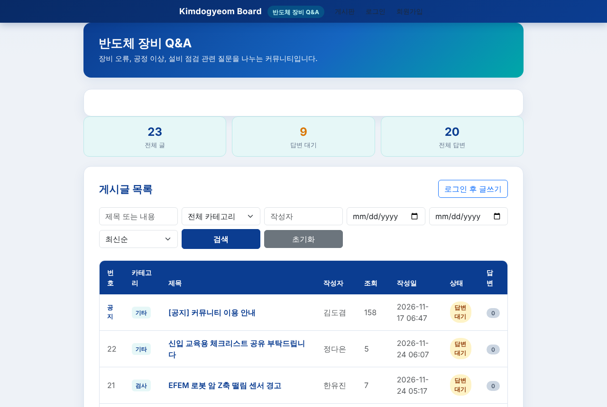
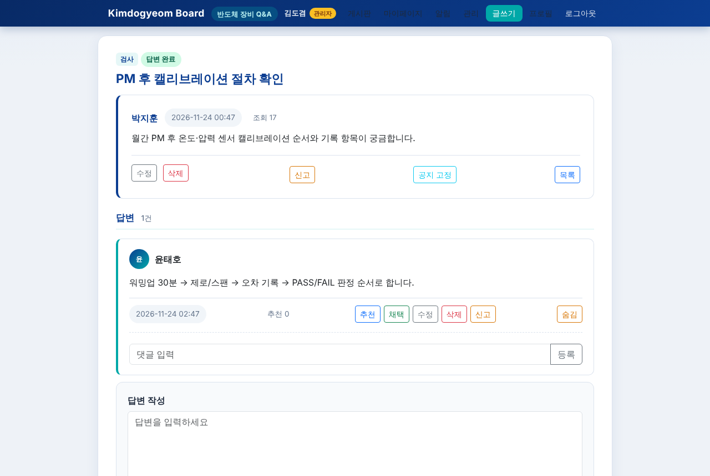
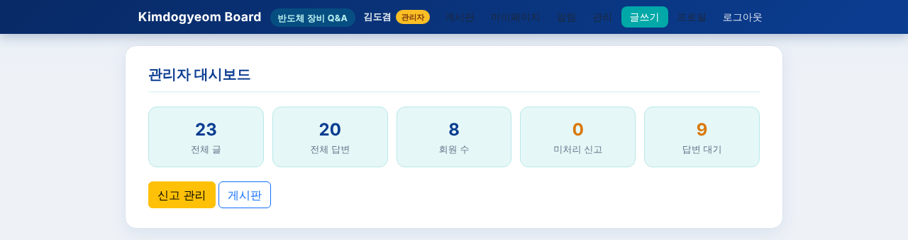

# KIMDOGYEOM Board

> 📂 [포트폴리오 (Notion)](https://iced-tarsier-455.notion.site/350af40f5e6680d19f93f1653925a3b8)

**Kimdogyeom Board**는 Spring Boot로 만든 반도체 장비 Q&A 커뮤니티입니다. 장비 알람, 공정 이상, 설비 점검에 관한 질문과 답변을 주고받습니다. 프레임워크활용심화 기말 대체 과제로 시작해, 수업의 기본 게시판에 회원 등급·검색·알림·신고·관리자 기능을 더했습니다.

| 게시글 목록 | 질문 상세 (답변·추천·채택·댓글) |
| --- | --- |
|  |  |



## 주요 기능

| 구분 | 기능 |
| --- | --- |
| 게시판 | 질문 목록·상세·등록·수정·삭제, 답변 등록·수정·삭제(질문 삭제 시 답변도 함께 삭제) |
| 회원 | 회원가입, 로그인·로그아웃, 프로필(닉네임·이메일·소개) 수정, 비밀번호 변경 |
| 등급 | 일반회원(USER) · 관리자(ADMIN). 비밀번호는 BCrypt로 저장 |
| 검색·목록 | 제목/내용 키워드, 카테고리, 작성자, 기간 검색 · 최신/조회/답변 많은 순 정렬 · 페이지당 10건 · 공지는 1페이지 맨 위에 고정 |
| 답변 | 베스트 답변 채택(질문 작성자 또는 관리자), 추천(1인 1회), 답변 댓글 |
| 첨부파일 | 질문 등록 시 파일 첨부, 상세 화면에서 내려받기 |
| 알림 | 내 질문에 답변이 달리거나 내 답변이 채택되면 알림 |
| 신고 | 질문·답변 신고 → 관리자가 처리 |
| 마이페이지 | 내 질문, 내 답변, 답변을 기다리는 내 질문 |
| 관리자 | 대시보드(글·답변·회원·미처리 신고·답변 대기 수), 신고 관리, 공지 고정/해제, 답변 숨김/해제 |
| 기타 | 조회수, 답변 대기/완료 표시, 403·404 안내 화면, 처음 실행할 때 샘플 데이터 자동 생성 |

### 등급별 권한

| 동작 | 비회원 | 일반회원 | 관리자 |
| --- | :---: | :---: | :---: |
| 목록·상세 보기 | ✅ | ✅ | ✅ |
| 질문·답변·댓글 작성, 추천, 신고 | ❌ | ✅ | ✅ |
| 내 글·답변 수정·삭제 | ❌ | ✅ | ✅ |
| 다른 사람 글·답변 수정·삭제 | ❌ | ❌ | ✅ |
| 공지 고정, 답변 숨김, 신고 처리, 관리자 메뉴 | ❌ | ❌ | ✅ |

수정·삭제·채택 권한은 `member/MemberAuthorizationService` 한 곳에서 판단합니다.

## 기술 스택

- Java 17, Spring Boot 4.0.3, Gradle
- Spring Security, Spring Data JPA, Thymeleaf, H2 Database (파일 모드)
- Bootstrap 5, Lombok

## 실행 방법

JDK 17이 필요합니다.

**Windows**

```bat
run-server.bat
```

`run-server.bat`은 8080 포트가 비어 있는지 확인한 뒤 `gradlew.bat bootRun`을 실행합니다. 이미 켜진 서버는 `stop-server.bat`으로 끕니다.

**Eclipse(STS)**: File → Import → Gradle → Existing Gradle Project로 불러온 뒤 `KimdogyeomboardApplication`을 Run As → Spring Boot App으로 실행합니다. 터미널과 Eclipse에서 동시에 실행하지 마세요(포트 충돌).

**macOS / Linux**

```bash
sh ./gradlew bootRun
```

서버는 이 PC에서만 접속할 수 있게 `127.0.0.1:8080`으로 열립니다(`application.properties`의 `server.address`).

| 화면 | 주소 |
| --- | --- |
| 게시판 | http://localhost:8080/ |
| 로그인 / 회원가입 | http://localhost:8080/member/login · http://localhost:8080/member/signup |
| 마이페이지 | http://localhost:8080/mypage |
| 관리자 대시보드 | http://localhost:8080/admin/dashboard |
| H2 Console | http://localhost:8080/h2-console |

### 테스트 계정 (비밀번호 모두 `1234`)

| 아이디 | 닉네임 | 등급 |
| --- | --- | --- |
| kimdogyeom | 김도겸 | 관리자 |
| parktech | 박지훈 | 일반회원 |
| leeequip | 이수민 | 일반회원 |
| hanwave | 한유진 | 일반회원 |
| choisfab | 최서연 | 일반회원 |
| kangmfc | 강민재 | 일반회원 |
| jungetch | 정다은 | 일반회원 |
| yoonpm | 윤태호 | 일반회원 |

DB를 처음 만들 때 위 계정과 함께 공지 1건과 질문 22건, 답변·댓글·추천 샘플이 자동으로 들어갑니다.

### 데이터 위치

| 항목 | 위치 |
| --- | --- |
| DB | `~/kimdogyeom.mv.db` (Windows: `C:\Users\{사용자}\kimdogyeom.mv.db`) |
| H2 Console 접속 | JDBC URL `jdbc:h2:~/kimdogyeom;AUTO_SERVER=TRUE`, 사용자 `sa`, 비밀번호 없음 |
| 첨부파일 | `~/kimdogyeom-uploads` (`app.upload.dir`로 변경 가능) |

샘플 데이터부터 다시 시작하려면 서버를 끈 뒤 `reset-db.bat`을 실행하고 서버를 다시 켭니다. 이 스크립트는 DB 파일만 지우고 첨부파일 폴더는 그대로 둡니다.

## 테스트

```bat
gradlew.bat test
```

macOS / Linux에서는 `sh ./gradlew test`. MockMvc 통합 테스트로 주요 화면이 열리는지(`PageRenderIntegrationTest`)와 관리자 기능(`AdminFunctionIntegrationTest`)을 확인합니다.

## 프로젝트 구조

```
src/main/java/com/mysite/kimdogyeomboard
├── question       질문, 검색·페이징, 첨부파일
├── answer         답변, 추천, 채택, 댓글, 숨김
├── member         회원가입·로그인, 프로필, 마이페이지, 권한 판단
├── notification   알림
├── report         신고
├── admin          관리자 대시보드, 신고 처리, 공지 고정
└── config         Spring Security, 샘플 데이터, 오류 화면 처리
src/main/resources/templates   Thymeleaf 화면
```

## 문서

- [과제설명서](docs/과제설명서.md): 구현 기능, DB 관계, 구현하면서 어려웠던 점, 화면 캡처 17장
- [제출안내](docs/제출안내.md): 기말 과제 제출 패키지 구성
- [실행 화면 캡처](docs/실행화면캡처/): 제출 당시(2026년 6월) 화면

제출할 때 만든 zip 파일은 저장소에서 뺐습니다. 필요하면 커밋 `cdcc557`에서 꺼낼 수 있습니다.
