# 프레임워크활용심화 기말고사 대체 과제 설명서

---

## 1. 기본 정보

| 항목 | 내용 |
|------|------|
| **과목명** | 프레임워크활용심화 |
| **소속** | 한국폴리텍대학 반도체융합캠퍼스 |
| **본인 이름** | 김도겸 (KIM DO GYEOM) |
| **프로젝트명** | KIMDOGYEOM |
| **게시판 제목** | Kimdogyeom Board |
| **패키지명** | com.mysite.kimdogyeomboard |
| **게시판 주제** | 반도체 장비 Q&A 커뮤니티 |
| **GitHub** | https://github.com/yaong832/KIMDOGYEOM |

---

## 2. 과제 개요

본 과제는 수업에서 학습한 SBB 게시판 구조를 바탕으로, **본인 영어 이름을 반영한 새로운 Spring Boot 프로젝트**를 직접 생성하고 게시판 기능을 처음부터 구현한 것입니다.

기존 `sbb` 프로젝트를 그대로 복사하지 않고, 프로젝트명·패키지명·화면 제목을 모두 본인 이름에 맞게 변경하였습니다. 게시판 주제는 **반도체 장비 Q&A**로 설정하였고, 카페·블로그처럼 **회원가입·로그인·등급(일반회원/관리자)** 을 적용하여 실제 커뮤니티와 유사하게 동작하도록 개선하였습니다.

지시서의 필수 기능(게시글 CRUD, 답변 등록, Bootstrap, H2)을 충족하면서, 검색·페이징·공지 고정·마이페이지·알림·신고·첨부파일·관리자 대시보드 등 **커뮤니티 확장 기능**을 추가 구현하였습니다.

---

## 3. 사용한 기술

| 구분 | 기술 |
|------|------|
| 언어 | Java 17 |
| 프레임워크 | Spring Boot 4.0.3 |
| 보안 | Spring Security |
| 빌드 도구 | Gradle |
| 템플릿 엔진 | Thymeleaf (Layout Dialect, Spring Security Dialect) |
| 데이터베이스 | **H2 Database** (파일 DB) |
| ORM | Spring Data JPA / Hibernate |
| 화면 디자인 | Bootstrap 5, CSS (`style.css`) |
| 기타 | Lombok, DevTools, BCrypt, Bean Validation, JPA Specification |

> **참고:** SQLite가 아닌 **H2 Database**를 사용합니다. 데이터는 `C:\Users\{사용자}\kimdogyeom.mv.db` 파일에 저장됩니다. 첨부파일은 `C:\Users\{사용자}\kimdogyeom-uploads` 폴더에 저장됩니다.

---

## 4. 프로젝트 구조

```
KIMDOGYEOM/
├── src/main/java/com/mysite/kimdogyeomboard/
│   ├── KimdogyeomboardApplication.java
│   ├── MainController.java
│   ├── DataNotFoundException.java
│   ├── config/
│   │   ├── SecurityConfig.java          ← 로그인·등급·CSRF
│   │   ├── DataInitializer.java         ← 테스트 계정·샘플 글 자동 생성
│   │   ├── GlobalExceptionHandler.java  ← 403/404 처리
│   │   ├── GlobalModelAdvice.java       ← 알림 미읽음 수
│   │   └── WebConfig.java               ← 업로드 경로·정적 리소스
│   ├── member/                          ← 회원·프로필·마이페이지
│   ├── question/                        ← 질문 CRUD·검색·첨부
│   ├── answer/                          ← 답변·추천·댓글
│   ├── admin/                           ← 관리자 대시보드·신고·공지
│   ├── notification/                    ← 알림
│   └── report/                          ← 신고
├── src/main/resources/
│   ├── templates/                       ← Thymeleaf 화면
│   ├── static/style.css
│   └── application.properties
├── src/test/java/                       ← 통합 테스트 15건
├── run-server.bat / stop-server.bat / reset-db.bat
└── build.gradle
```

---

## 5. 구현한 기능 목록

### 5.1 필수 기능 (지시서 기준)

| 번호 | 기능 | URL | 설명 |
|------|------|-----|------|
| 1 | 게시글 목록 조회 | `GET /question/list` | 번호, 카테고리, 제목, 작성자, 조회수, 작성일, 상태, 답변 수 |
| 2 | 루트 접속 | `GET /` | 게시글 목록으로 자동 이동 |
| 3 | 게시글 상세 조회 | `GET /question/detail/{id}` | 제목, 내용, 조회수, 답변·댓글·추천 표시 |
| 4 | 게시글 등록 | `GET/POST /question/create` | 로그인 후 작성, 카테고리·첨부파일 지원 |
| 5 | 게시글 수정 | `GET/POST /question/modify/{id}` | 작성자 또는 관리자만 수정 가능 |
| 6 | 게시글 삭제 | `POST /question/delete/{id}` | 확인창 후 삭제, cascade로 답변 함께 삭제 |
| 7 | 답변 등록 | `POST /answer/create/{id}` | 로그인 후 답변 저장 및 화면 출력 |

### 5.2 MVC 구조

```
브라우저 → Controller → Service → Repository → H2 DB → Thymeleaf 화면
```

### 5.3 데이터베이스 관계

| 테이블 | 관계 | 설명 |
|--------|------|------|
| MEMBER | 회원 | 아이디, 비밀번호(BCrypt), 닉네임, 이메일, 소개, 등급(USER/ADMIN) |
| QUESTION | 질문 | Member(작성자) N:1, 카테고리, 조회수, 공지(pinned), 채택 답변 |
| ANSWER | 답변 | Question N:1, Member N:1, hidden(숨김), likeCount, 채택 여부 |
| ANSWER_LIKE | 답변 추천 | Member + Answer 복합 유니크 |
| ANSWER_COMMENT | 답변 댓글 | Answer N:1, Member N:1 |
| QUESTION_ATTACHMENT | 첨부파일 | Question N:1, 저장 경로·원본 파일명 |
| NOTIFICATION | 알림 | 수신 회원, 메시지, 읽음 여부, 링크 URL |
| REPORT | 신고 | 대상(질문/답변), 신고자, 사유, 처리 상태 |

| 관계 | 설정 |
|------|------|
| Question → Answer | `@OneToMany(cascade = REMOVE)` — 질문 삭제 시 답변 함께 삭제 |
| Question → Attachment | `@OneToMany(cascade = REMOVE)` |

### 5.4 회원·등급 기능

| 기능 | URL | 설명 |
|------|-----|------|
| 회원가입 | `GET/POST /member/signup` | 일반회원(USER) 가입 |
| 로그인 | `GET/POST /member/login` | Spring Security 폼 로그인 |
| 로그아웃 | `POST /member/logout` | 세션 종료, 목록으로 이동 |
| 프로필 수정 | `GET/POST /member/profile` | 닉네임, 이메일, 소개 수정 |
| 비밀번호 변경 | `GET/POST /member/password` | 별도 페이지, 변경 후 SecurityContext 갱신 |
| 등급 구분 | USER / ADMIN | 일반회원 / 관리자 |

### 5.5 등급별 권한

| 동작 | 비회원 | 일반회원(USER) | 관리자(ADMIN) |
|------|--------|----------------|---------------|
| 목록·상세 보기 | ✅ | ✅ | ✅ |
| 질문·답변 작성 | ❌ | ✅ | ✅ |
| 본인 글/답변 수정·삭제 | ❌ | ✅ | ✅ |
| 타인 글/답변 수정·삭제 | ❌ | ❌ | ✅ |
| 답변 숨김/숨김해제 | ❌ | ❌ | ✅ |
| 공지 고정/해제 | ❌ | ❌ | ✅ |
| 관리자 메뉴 | ❌ | ❌ | ✅ |

### 5.6 추가 커뮤니티 기능

| 기능 | URL / 설명 |
|------|------------|
| 검색·필터 | 제목/내용 키워드, 카테고리, 작성자, 기간, 정렬(최신/조회/답변많은순) |
| 페이징 | 페이지당 10건, 공지는 1페이지 상단 고정·번호 제외 |
| 조회수 | 상세 조회 시 `viewCount` +1 (동일 사용자 재방문도 증가) |
| 베스트 답변 채택 | 질문 작성자 또는 관리자가 답변 채택 |
| 답변 추천 | 로그인 회원 1인 1회 추천 |
| 답변 댓글 | 답변에 댓글 등록·삭제 |
| 첨부파일 | 글 등록 시 업로드, 상세에서 다운로드 |
| 신고 | 질문·답변 신고 → 관리자 처리 |
| 알림 | 답변 등록·채택 시 작성자에게 알림 |
| 마이페이지 | 내 글 / 내 답변 / 답변 대기 글 통계·목록 |
| 관리자 대시보드 | 전체 글·답변·회원·신고·답변대기 통계 |
| 답변 숨김(블라인드) | 관리자 전용, 공개 답변 수에 반영 |
| 상태 뱃지 | 답변대기 / 답변완료 |
| 에러 페이지 | 403(권한 없음), 404(데이터 없음) |
| 샘플 데이터 | DB 최초 생성 시 반도체 Q&A 글·답변·댓글·추천 자동 생성 |
| 통합 테스트 | `PageRenderIntegrationTest`, `AdminFunctionIntegrationTest` 등 **15건** |

---

## 6. 실행 방법

### 6.1 Eclipse(STS)에서 실행

1. **File → Import → Gradle → Existing Gradle Project**
2. 프로젝트 경로: `D:\stsproject\KIMDOGYEOM`
3. **Gradle Refresh** + **Project → Clean** 실행
4. `KimdogyeomboardApplication.java` → **Run As → Spring Boot App**
5. Console에 `Started KimdogyeomboardApplication` 확인

> 포트 충돌 방지: 실행 전 `stop-server.bat` 사용. 터미널과 Eclipse에서 **동시에 서버를 실행하지 않습니다.**

### 6.2 터미널에서 실행

```bash
cd KIMDOGYEOM
run-server.bat
```

또는 `gradlew.bat bootRun`

| 화면 | 주소 |
|------|------|
| 메인 (목록) | http://localhost:8080/ |
| 로그인 | http://localhost:8080/member/login |
| 회원가입 | http://localhost:8080/member/signup |
| 마이페이지 | http://localhost:8080/mypage |
| 관리자 | http://localhost:8080/admin/dashboard |
| H2 Console | http://localhost:8080/h2-console |

### 6.3 테스트 계정 (비밀번호 모두 `1234`)

| 아이디 | 닉네임 | 등급 |
|--------|--------|------|
| kimdogyeom | 김도겸 | 관리자 |
| parktech | 박지훈 | 일반회원 |
| leeequip | 이수민 | 일반회원 |
| hanwave | 한유진 | 일반회원 |
| choisfab | 최서연 | 일반회원 |
| kangmfc | 강민재 | 일반회원 |
| jungetch | 정다은 | 일반회원 |
| yoonpm | 윤태호 | 일반회원 |

### 6.4 샘플 게시글 (자동 생성)

DB가 **처음 생성될 때** 공지 1건 포함 **22건**의 반도체 Q&A 샘플 글이 등록됩니다. (페이징 확인 가능)

| 제목 (예시) | 작성자 | 특징 |
|-------------|--------|------|
| [공지] 커뮤니티 이용 안내 | 김도겸 | 상단 고정 공지 |
| CVD 챔버 Pressure High 알람 대처 방법 | 박지훈 | 답변완료, 채택·추천·댓글 |
| 식각 장비 레시피 파라미터 변경 시 주의사항 | 김도겸 | **답변대기** |
| 로드락 펌프 이상 진동 원인 문의 | 이수민 | 답변 2건 |
| PM 후 캘리브레이션 절차 확인 | 박지훈 | 답변완료 |

기존 DB를 사용 중이면 `reset-db.bat` 실행 후 서버를 다시 시작하세요.

### 6.5 H2 Console 접속 정보

| 항목 | 값 |
|------|-----|
| JDBC URL | `jdbc:h2:~/kimdogyeom;AUTO_SERVER=TRUE` |
| User Name | `sa` |
| Password | (비워 둠) |

### 6.6 DB 확인 SQL

```sql
SELECT * FROM MEMBER;
SELECT ID, SUBJECT, VIEW_COUNT, PINNED FROM QUESTION ORDER BY ID;
SELECT ID, CONTENT, HIDDEN FROM ANSWER ORDER BY ID;
SELECT * FROM NOTIFICATION;
SELECT * FROM REPORT;
```

---

## 7. 실행 화면 캡처 (제출용)

아래는 실제 실행 화면 캡처입니다. (`실행화면캡처` 폴더, 01~17)

### 7.1 기본·필수 기능

**01. Eclipse 프로젝트 구조**

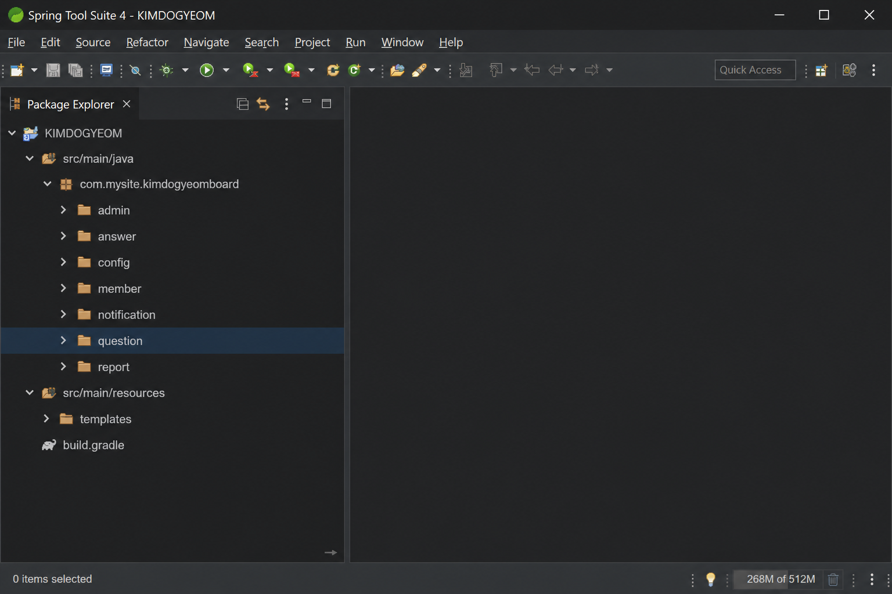

**02. 게시글 목록** — 공지 고정, 검색·페이징, 통계 카드

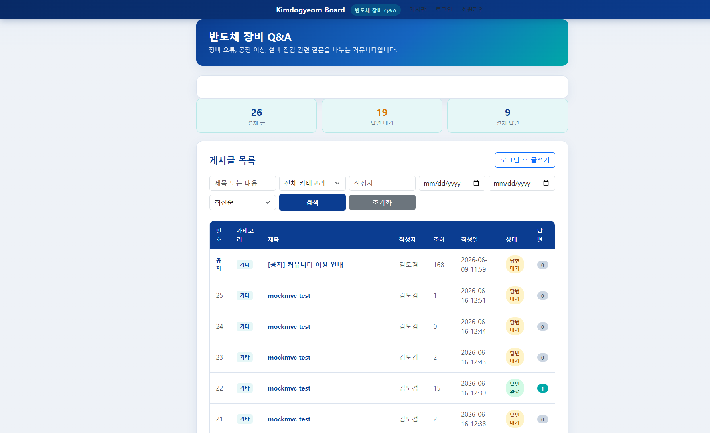

**03. 로그인 화면**

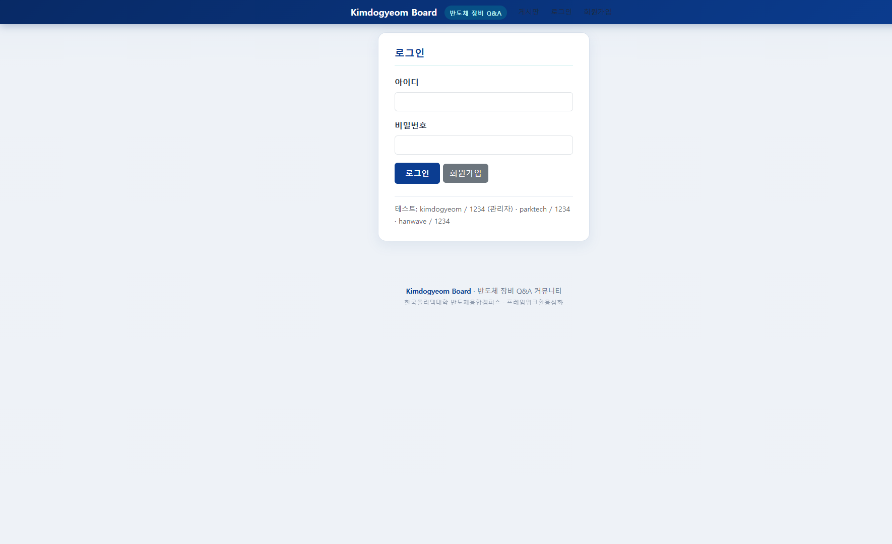

**04. 회원가입 화면**

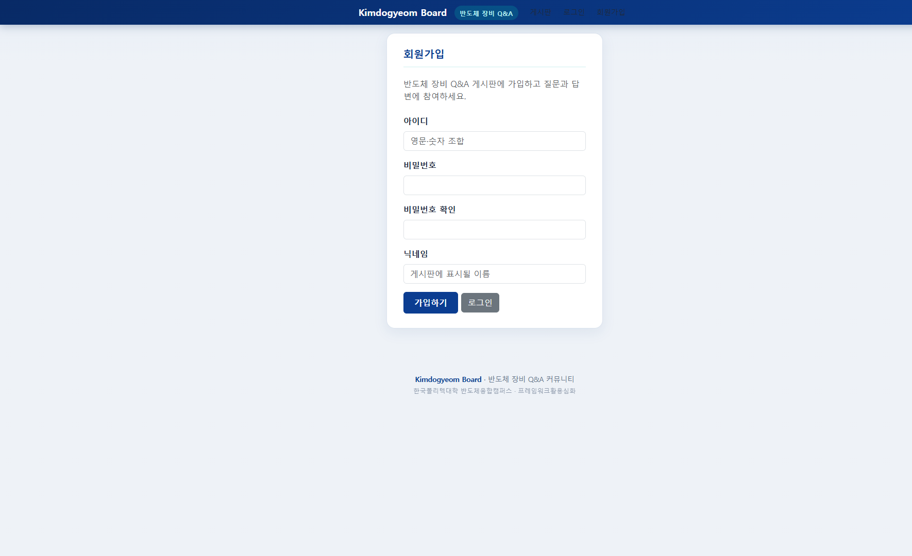

**05. 로그인 후 목록** — 관리자 메뉴·글쓰기 버튼


**06. 게시글 상세** — 조회수, 답변·채택·추천·댓글

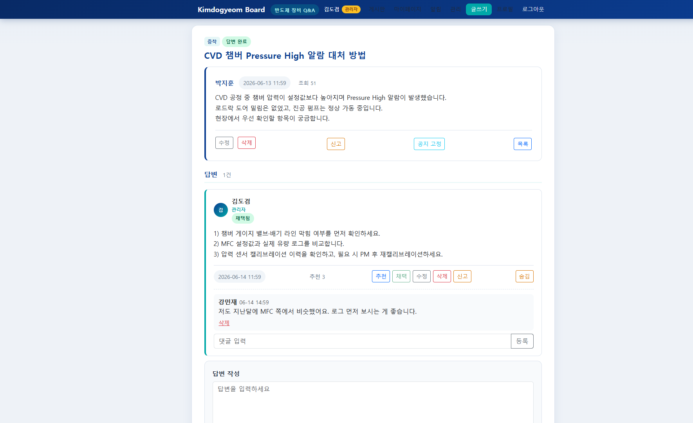

**07. 게시글 등록** — 카테고리·첨부파일

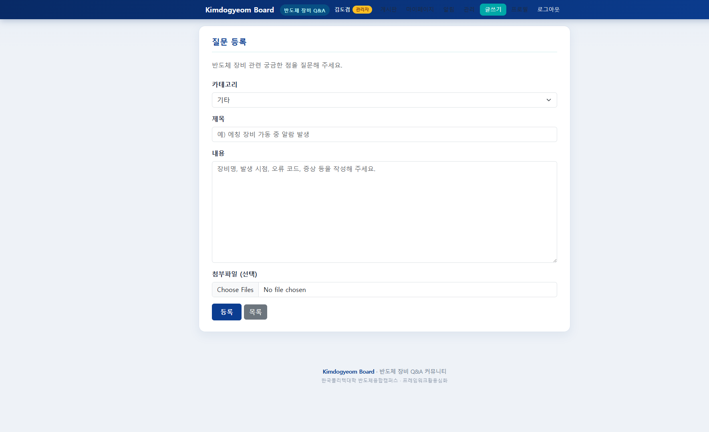

**08. 게시글 수정**

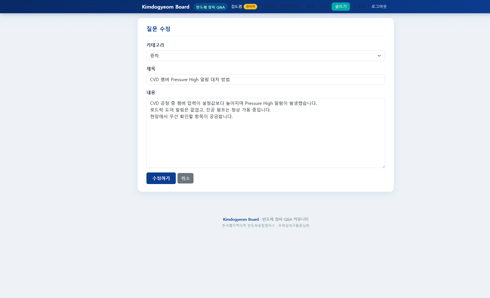

**09. 답변 등록 후 상세**


### 7.2 H2 Database

**10. H2 Console 접속 화면**

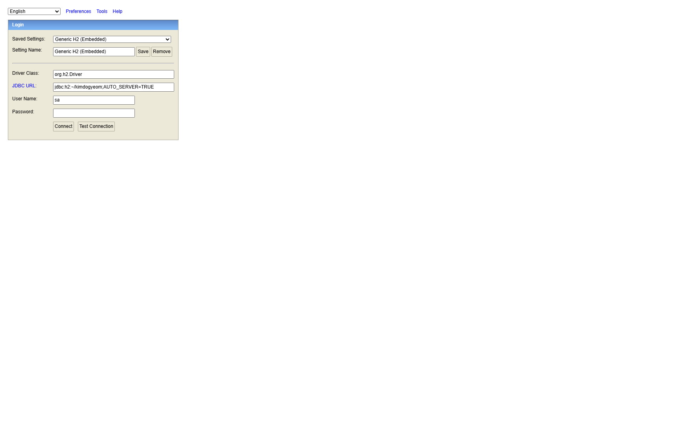

**11. QUESTION 테이블 조회**

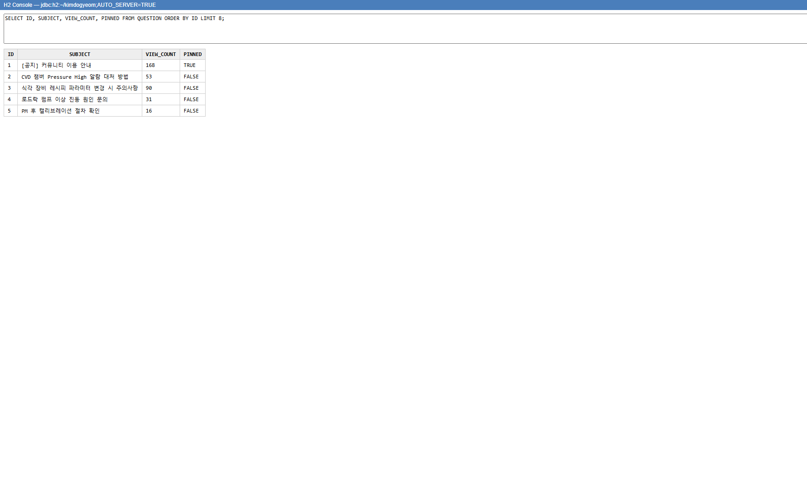

**12. ANSWER 테이블 조회**

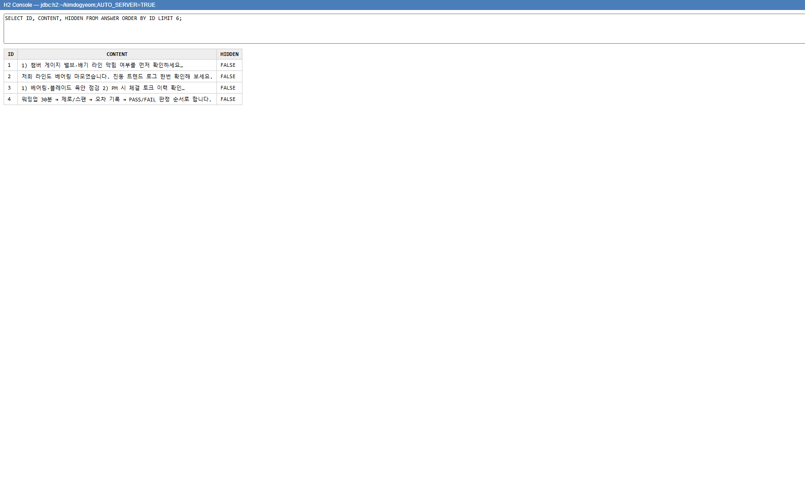

### 7.3 추가 커뮤니티 기능

**13. 마이페이지** — 내 질문·답변·답변대기 통계

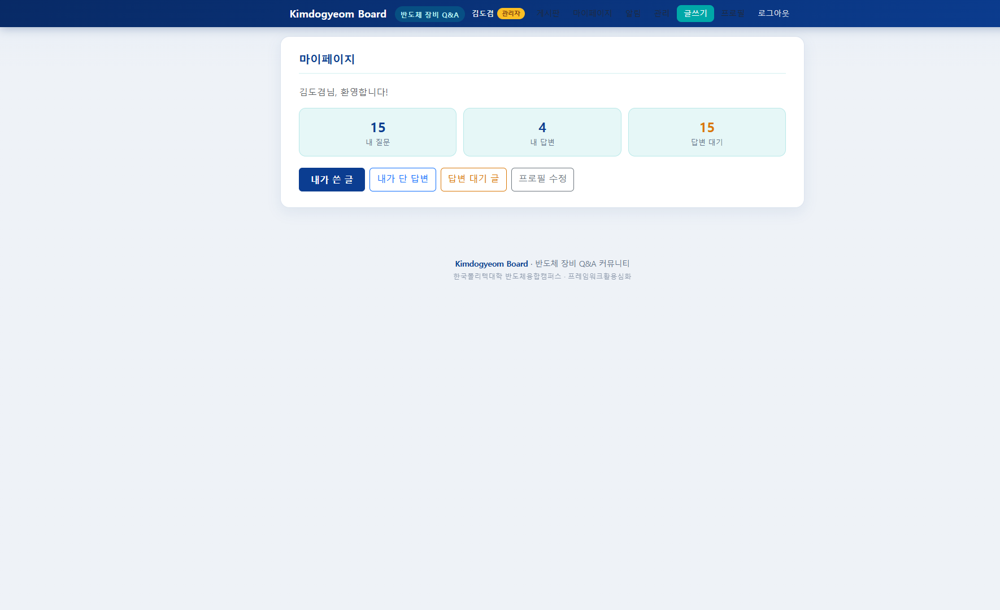

**14. 관리자 대시보드**

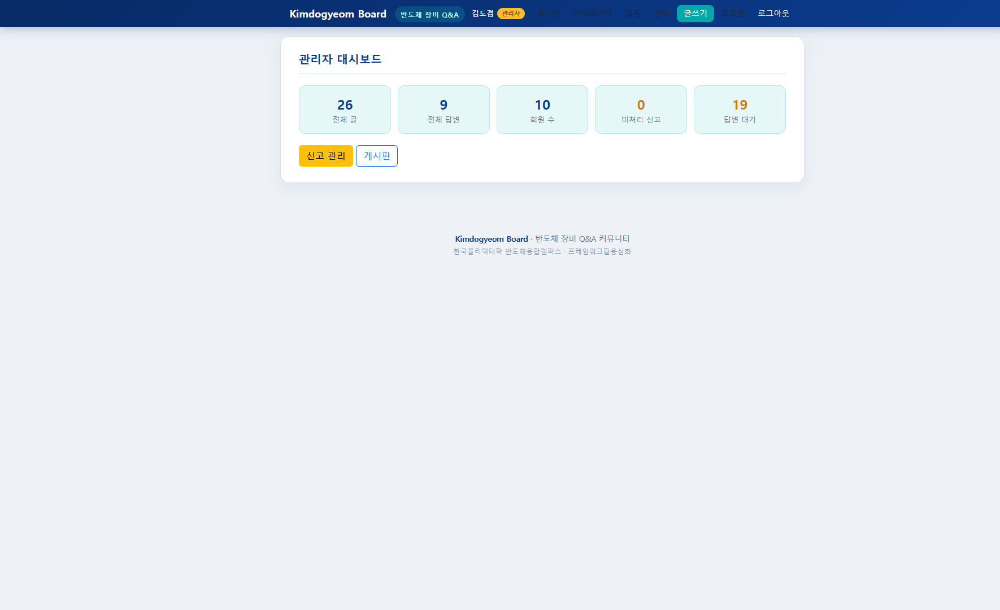

**15. 관리자 신고 관리**

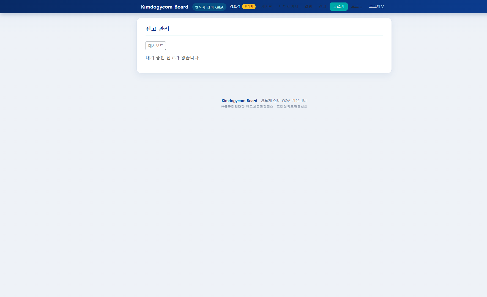

**16. 비밀번호 변경** (별도 페이지)

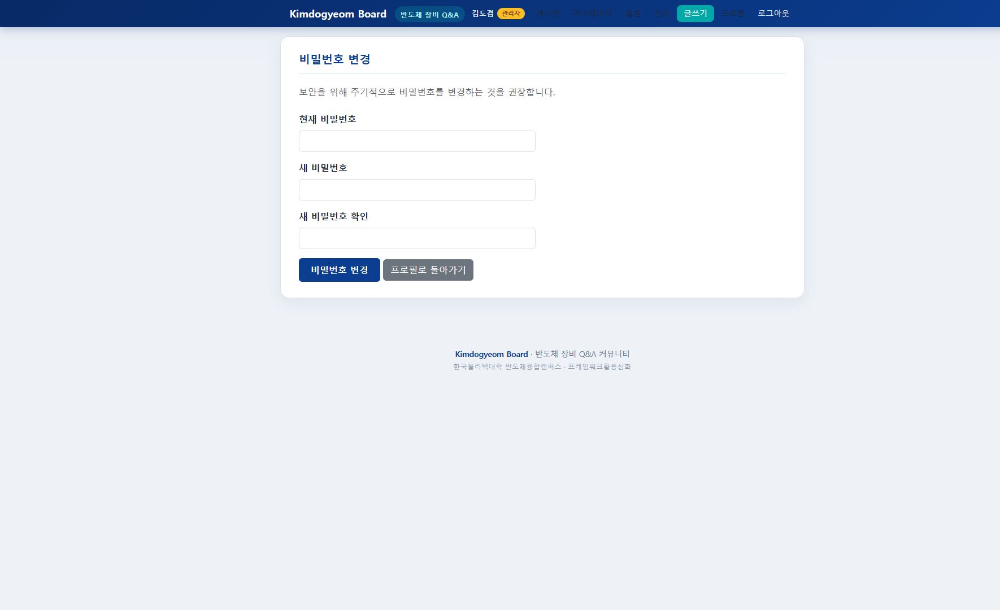

**17. 알림 목록**

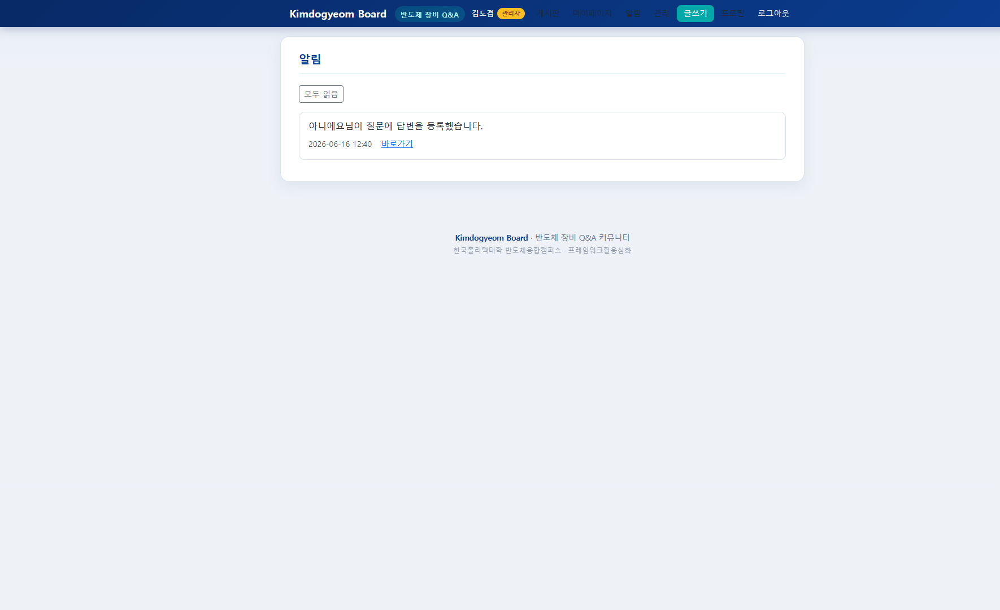

---

## 8. 기능 테스트 순서 (캡처용)

| 순서 | 캡처 내용 |
|------|-----------|
| 1 | STS/Eclipse **프로젝트 구조** |
| 2 | **게시글 목록** (공지·페이징·검색) |
| 3 | **로그인** → `kimdogyeom` / `1234` |
| 4 | **회원가입** 화면 |
| 5 | 로그인 후 **목록** (관리자 메뉴) |
| 6 | **게시글 상세** (답변·댓글·추천) |
| 7 | **게시글 등록** (첨부파일) |
| 8 | **게시글 수정** |
| 9 | **답변 등록** 후 상세 |
| 10~12 | H2 Console — 접속, QUESTION, ANSWER |
| 13 | **마이페이지** |
| 14~15 | **관리자** 대시보드·신고 |
| 16 | **비밀번호 변경** |
| 17 | **알림** |

---

## 9. 화면 디자인 (Bootstrap 적용)

| 화면 | 적용 요소 |
|------|-----------|
| 공통 | `layout.html` 상속, 네비게이션 바(1200px), 반도체 테마 컬러 |
| 목록 | 테이블, 상태 뱃지, 히어로 배너, 통계 카드, 검색 폼, 페이지네이션(활성 페이지 파란색) |
| 상세 | 카드, 작성자 닉네임, 조회수, 답변·댓글·채택 뱃지 |
| 등록/수정 | `form-control`, 카테고리 선택, 파일 업로드 |
| 로그인/가입 | CSRF 토큰, `alert` 메시지 |
| 마이페이지 | 통계 카드 3종, 탭형 메뉴 |
| 관리자 | 대시보드 통계 카드, 신고 목록 테이블 |

---

## 10. 구현하면서 어려웠던 점

1. **MVC 계층 연결** — Controller, Service, Repository 역할 분리를 이해하며 구현하였습니다.

2. **Thymeleaf 템플릿 상속** — `layout.html`과 `th:replace` 문법 적용 시 화면 구조를 맞추는 데 시간이 걸렸습니다.

3. **Spring Security 적용** — 로그인, 회원가입, 등급별 권한, CSRF 토큰, 비로그인 상세 페이지 권한 처리를 학습하며 구현하였습니다.

4. **H2 DB 잠금 오류** — 서버 중복 실행 시 DB 파일 잠금이 발생하여 `AUTO_SERVER=TRUE` 옵션을 추가하였습니다.

5. **첨부파일 업로드** — Tomcat 작업 디렉터리 기준 상대경로 문제를 `${user.home}/kimdogyeom-uploads` 절대경로로 수정하였습니다.

6. **Eclipse 빌드** — `@RequestParam`·`@PathVariable` 이름 미지정 시 500 오류가 발생하여, 이름을 명시하고 `build.gradle`에 `-parameters` 옵션을 추가하였습니다.

7. **8080 포트 충돌** — `stop-server.bat`으로 한 곳에서만 서버를 실행하도록 관리하였습니다.

---

## 11. 본인이 추가로 꾸민 부분 / 개선한 부분

### 11.1 프로젝트 개인화
- 프로젝트명 `KIMDOGYEOM`, 패키지 `com.mysite.kimdogyeomboard`
- 화면 제목 **Kimdogyeom Board**, 주제 **반도체 장비 Q&A**

### 11.2 회원·등급 시스템
- 회원가입 / 로그인 / 로그아웃 / 프로필 / 비밀번호 변경
- 일반회원(USER) / 관리자(ADMIN) 등급 구분

### 11.3 커뮤니티 확장
- 검색·필터·정렬·페이징, 공지 상단 고정
- 답변 추천·댓글·채택, 첨부파일, 알림, 신고
- 마이페이지, 관리자 대시보드·신고 처리·답변 숨김

### 11.4 UI/UX·테스트 데이터
- 반도체 테마 컬러, 히어로 배너, 통계 카드
- 샘플 회원 8명·Q&A 글 22건 자동 생성
- 통합 테스트 15건 (`gradlew test` 전부 통과)

---

## 12. 제출물 체크리스트

- [x] 본인 영어 이름 기반 프로젝트 생성
- [x] 패키지명에 본인 이름 반영 (`com.mysite.kimdogyeomboard`)
- [x] 게시글 CRUD + 답변 등록
- [x] Bootstrap + layout.html
- [x] H2 DB 연동 (QUESTION, ANSWER, MEMBER 등)
- [x] 회원가입·로그인·등급 (추가 구현)
- [x] 과제 설명 문서 작성 (본 문서)
- [x] GitHub 업로드
- [x] 실행 화면 캡처 17장 (`실행화면캡처` 폴더, 01~17)
- [x] 프로젝트 zip 압축

### zip 압축 방법

1. `D:\stsproject\KIMDOGYEOM` 폴더 우클릭 → **압축**
2. 파일명: `KIMDOGYEOM_김도겸_제출.zip`
3. `build` 폴더는 용량이 크므로 제외해도 됩니다 (교수자 PC에서 Gradle로 재빌드 가능)

---

## 13. 마무리

이번 과제를 통해 Spring Boot MVC 구조에서 **Controller → Service → Repository → Entity → Template → H2 Database**가 어떻게 연결되는지 직접 구현하며 이해할 수 있었습니다.

수업에서 배운 게시판 기본 기능을 충족하면서, **회원·등급 시스템**과 **반도체 장비 Q&A 커뮤니티 확장 기능**을 추가하여 본인만의 게시판으로 발전시킨 것이 이 프로젝트의 특징입니다.

---

**작성자: 김도겸 (KIM DO GYEOM)**  
**작성일: 2026년 6월**  
**GitHub: https://github.com/yaong832/KIMDOGYEOM**
